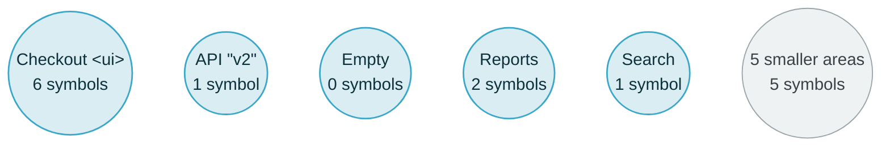

### 🌱 trail blast radius

**5 areas changed → 10 areas can be affected.** 15 dependent symbols (2 [inferred]), depth 2.
Tests: **no test reaches Billing**; Orders, Lib have tests the diff did not touch; 1 area updated its tests.
⚠️ **6 callers left behind** by a changed declaration: `useA` (`src/use.ts:5`), `useB` (`src/use.ts:L4-L9`) [inferred], `useC` (`src/use.ts:7`), `useD` (`src/use.ts:8`), `useE` (`src/use.ts:L4-L9`), +1 more, all in `--format json`. The diff did not edit their calls.
Tag: @ada — 3 of 15 areas · **Bob Builder** — Reports · @cyd — Billing, Checkout <ui> · @dee — Math



| Can be affected | Symbols | Nearest hop | Reached from |
| --- | --: | --- | --- |
| Checkout <ui> | 6 | `src/user.ts:L1-L4` useTotal — calls, depth 1 | Math, src/y.ts +1 |
| API "v2" | 1 | `src/api.ts:L3-L9` route — calls, depth 1 | Orders, src/y.ts |
| Empty | 0 | — | — |
| Reports | 2 | `src/report.ts:L2-L5` monthly — calls, depth 2 [inferred] | Math |
| Search | 1 | `src/search.ts:L1` find — calls, depth 1 | Lib |
| Tax | 1 | `src/tax.ts:L1-L2` gst — calls, depth 2 | Math |
| _4 smaller areas_ | 4 | Zed, Yak, Xen, … | see below |

<details>
<summary><strong>Who knows this code</strong> — 3 people across 15 areas</summary>

| Area | Who knows it |
| --- | --- |
| **Math** · changed | @ada — 1 commit, last today · Bob Builder — 4 commits, last today |
| **Billing** · changed | @cyd — 2 commits, last today |
| **Checkout <ui>** · affected | @ada — 1 commit, last today · @cyd — 2 commits, last today |
| **Reports** · affected | Bob Builder — 4 commits, last today |
| **Orders** · changed | _only you — nobody else has touched these files_ |
| **Lib** · changed | _only you — nobody else has touched these files_ |
| **Docs** · changed | _only you — nobody else has touched these files_ |
| **API "v2"** · affected | _only you — nobody else has touched these files_ |
| _…7 further areas_ | |

_Ownership is git history over each area's own files, weighted towards recent work (120-day half-life). Merge commits and bots are dropped, and you are dropped from your own PR. A name with no `@` has no GitHub handle in its commit email — tag them by hand, or add a `.mailmap` entry. A suggestion from history, not a CODEOWNERS rule._

</details>

<details>
<summary><strong>All 15 dependent symbols</strong>, grouped by area</summary>

**Checkout <ui>** — 6 symbols in 2 files

- `src/user.ts:L1-L4` — useTotal (calls, depth 1)
  ```3: return computeTotal(x) + 1;```
- `src/view.ts:L1-L3` — View (calls, depth 1) [inferred]
  ```1: import { order } from './order.js';```
- `deploy/Dockerfile:L1-L2` — Deploy (calls, depth 2)
- `src/view.ts:L0-L1` — Header (calls, depth 2)
- `src/missing.ts:L1-L2` — Gone (calls, depth 2)
- `src/plain.ts:L1-L2` — Plain (calls, depth 2)

**API "v2"** — 1 symbol in 1 file

- `src/api.ts:L3-L9` — route (calls, depth 1)
  ```4: export function route() { return compute(1); }```

**Empty** — 0 symbols in 1 file


**Reports** — 2 symbols in 1 file

- `src/report.ts:L2-L5` — monthly (calls, depth 2) [inferred]
  ```3: import { computeTotal as t } from "../src/math";```
- `src/report.ts:L6-L9` — weekly (calls, depth 2)
  ```7: const n = require("lib/a.b.ts");```

**Search** — 1 symbol in 1 file

- `src/search.ts:L1` — find (calls, depth 1)
  ```1: export const find = () => compute;```

**Tax** — 1 symbol in 1 file

- `src/tax.ts:L1-L2` — gst (calls, depth 2)

**Zed** — 1 symbol in 1 file

- `src/zed.ts:L1-L2` — zed (calls, depth 2)

**Yak** — 1 symbol in 1 file

- `src/yak.ts:L1-L2` — yak (calls, depth 2)

**Xen** — 1 symbol in 1 file

- `src/xen.ts:L1-L2` — xen (calls, depth 2)

**Wren** — 1 symbol in 1 file

- `src/wren.ts:L1-L2` — wren (calls, depth 2)

</details>
<details>
<summary><strong>Test signal</strong> per changed area — 1 ✓ · 2 ⚠ · 1 ✗ · 1 –</summary>

_Reached = a node under a test path has a resolved edge into the changed symbol. It undercounts anything called indirectly — through a CLI, a spawned process or a dynamic import — so read a low ratio as “look here”, never as a coverage gate._

- ✓ **Math** — 1 of 2 reached · 2 test files changed here: `test/math.test.ts`, `test/sum.test.ts`
  - not reached: `u1`, `u2`, `u3`, `u4`, `u5`, `u6`, `u7`, `u8`, …2 more
- ⚠ **Orders** — 1 of 1 reached · 2 test files reach it, none changed here
  - not reached: `late`
- ⚠ **Lib** — 1 test file reaches it, none changed here
- ✗ **Billing** — 0 of 3 reached · no test file reaches it
- – **Docs** — no function, method or class changed here

</details>
<details>
<summary><strong>Tests reaching this change</strong> — 23 test files, full closure</summary>

- `test/math.test.ts` — changed in this diff
- `test/a.test.ts` — depth 2 [inferred] · a, b, c +2
- `test/b.test.ts` — depth 3 · a, b, c
- `test/c.test.ts` — depth 1
- `test/n0.test.ts` — depth 2 · x
- `test/n1.test.ts` — depth 2 · x
- `test/n2.test.ts` — depth 2 · x
- `test/n3.test.ts` — depth 2 · x
- `test/n4.test.ts` — depth 2 · x
- `test/n5.test.ts` — depth 2 · x
- `test/n6.test.ts` — depth 2 · x
- `test/n7.test.ts` — depth 2 · x
- `test/n8.test.ts` — depth 2 · x
- `test/n9.test.ts` — depth 2 · x
- `test/n10.test.ts` — depth 2 · x
- `test/n11.test.ts` — depth 2 · x
- `test/n12.test.ts` — depth 2 · x
- `test/n13.test.ts` — depth 2 · x
- `test/n14.test.ts` — depth 2 · x
- `test/n15.test.ts` — depth 2 · x
- …3 more, all in `--format json`

_Note: a test that runs the code through a CLI or a spawned process has no edge, so it is not listed._

</details>
<details>
<summary>25 test suites also reference this code</summary>

3 symbols, kept out of the diagram and the table so they cannot crowd out the areas a reviewer has to look at.

- `test/t0.test.ts`
- `test/t1.test.ts`
- `test/t10.test.ts`
- `test/t11.test.ts`
- `test/t12.test.ts`
- `test/t13.test.ts`
- `test/t14.test.ts`
- `test/t15.test.ts`
- `test/t16.test.ts`
- `test/t17.test.ts`
- `test/t18.test.ts`
- `test/t19.test.ts`
- `test/t2.test.ts`
- `test/t20.test.ts`
- `test/t21.test.ts`
- `test/t22.test.ts`
- `test/t23.test.ts`
- `test/t24.test.ts`
- `test/t3.test.ts`
- `test/t4.test.ts`
- …5 more

</details>

⚠️ 6 deleted files (old/a.ts, old/b.ts, old/c.ts, old/d.ts, old/e.ts) — their dependents cannot be computed from a graph built at this commit, since the files are gone from it.
⚠️ 2 changed files not in the graph (notes/plan.xyz, notes/other.xyz) — no parser claims the extension, or the index predates the file.
⚠️ 21 calls naming a changed symbol (name1 (1), name2 (2), name3 (3), name4 (4), name5 (5)) did not resolve to one definition — their callers are not counted above, so this may undercount. `trail callers <name>` lists them.

<sub>`trail blast` · main...HEAD · depth 2 · 3 changed files</sub>
