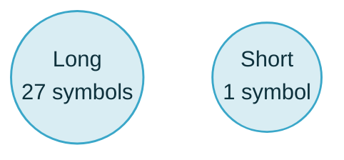

### 🌱 trail blast radius

**4 areas changed → 2 areas can be affected.** 28 dependent symbols, depth 3.
Tests: Ledger, Rates have tests the diff did not touch; 2 areas updated their tests.
⚠️ **1 caller left behind** by a changed declaration: `useA` (`src/use.ts:5`). The diff did not edit its call.
Tag: @ada — Math

| Can be affected | Symbols | Nearest hop | Reached from |
| --- | --: | --- | --- |
| Long | 27 | `src/long.ts:L1` f1 — calls, depth 1 | Tax, Rates |
| Short | 1 | `src/short.ts:L1` g — calls, depth 2 | Rates |

<strong>Who knows this code</strong> — 1 person across 6 areas

| Area | Who knows it |
| --- | --- |
| **Math** · changed | @ada — 2 commits, last today |
| **Tax** · changed | _only you — nobody else has touched these files_ |
| **Ledger** · changed | _only you — nobody else has touched these files_ |
| **Rates** · changed | _only you — nobody else has touched these files_ |
| **Long** · affected | _only you — nobody else has touched these files_ |
| **Short** · affected | _only you — nobody else has touched these files_ |

_Ownership is git history over each area's own files, weighted towards recent work (120-day half-life). Merge commits and bots are dropped, and you are dropped from your own PR. A name with no `@` has no GitHub handle in its commit email — tag them by hand, or add a `.mailmap` entry. A suggestion from history, not a CODEOWNERS rule._

<strong>All 28 dependent symbols</strong>, grouped by area

**Long** — 27 symbols in 1 file

- `src/long.ts:L1` — f1 (calls, depth 1)
- `src/long.ts:L2` — f2 (calls, depth 1)
- `src/long.ts:L3` — f3 (calls, depth 1)
- `src/long.ts:L4` — f4 (calls, depth 1)
- `src/long.ts:L5` — f5 (calls, depth 1)
- `src/long.ts:L6` — f6 (calls, depth 1)
- `src/long.ts:L7` — f7 (calls, depth 1)
- `src/long.ts:L8` — f8 (calls, depth 1)
- `src/long.ts:L9` — f9 (calls, depth 1)
- `src/long.ts:L10` — f10 (calls, depth 1)
- `src/long.ts:L11` — f11 (calls, depth 1)
- `src/long.ts:L12` — f12 (calls, depth 1)
- `src/long.ts:L13` — f13 (calls, depth 1)
- `src/long.ts:L14` — f14 (calls, depth 1)
- `src/long.ts:L15` — f15 (calls, depth 1)
- `src/long.ts:L16` — f16 (calls, depth 1)
- `src/long.ts:L17` — f17 (calls, depth 1)
- `src/long.ts:L18` — f18 (calls, depth 1)
- `src/long.ts:L19` — f19 (calls, depth 1)
- `src/long.ts:L20` — f20 (calls, depth 1)
- `src/long.ts:L21` — f21 (calls, depth 1)
- `src/long.ts:L22` — f22 (calls, depth 1)
- `src/long.ts:L23` — f23 (calls, depth 1)
- `src/long.ts:L24` — f24 (calls, depth 1)
- `src/long.ts:L25` — f25 (calls, depth 1)
- `src/long.ts:L26` — f26 (calls, depth 1)
- `src/long.ts:L27` — f27 (calls, depth 1)

**Short** — 1 symbol in 1 file

- `src/short.ts:L1` — g (calls, depth 2)

<strong>Test signal</strong> per changed area — 2 ✓ · 2 ⚠

_Reached = a node under a test path has a resolved edge into the changed symbol. It undercounts anything called indirectly — through a CLI, a spawned process or a dynamic import — so read a low ratio as “look here”, never as a coverage gate._

- ✓ **Math** — 1 of 1 reached · 1 test file changed here: `test/m.test.ts`
- ✓ **Tax** — 1 of 1 reached · 1 test file changed here: `test/m.test.ts`
- ⚠ **Ledger** — 1 of 1 reached · 1 test file reaches it, none changed here
- ⚠ **Rates** — 1 of 1 reached · 1 test file reaches it, none changed here

<strong>Tests reaching this change</strong> — 1 test file, full closure

- `test/m.test.ts` — changed in this diff

_Note: a test that runs the code through a CLI or a spawned process has no edge, so it is not listed._

2 test suites also reference this code

0 symbols, kept out of the diagram and the table so they cannot crowd out the areas a reviewer has to look at.

- `test/a.test.ts`
- `test/b.test.ts`

⚠️ 3 calls naming a changed symbol (a (2), b (1)) did not resolve to one definition — their callers are not counted above, so this may undercount. `trail callers <name>` lists them.

`trail blast` · main...HEAD · depth 3 · 2 changed files
